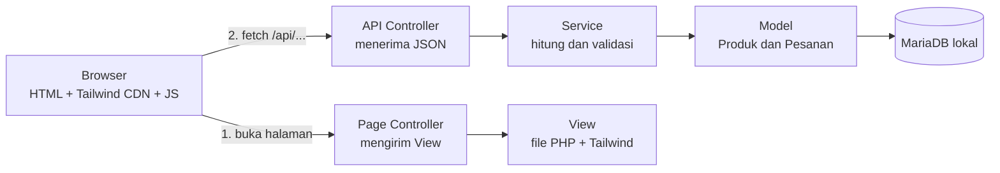
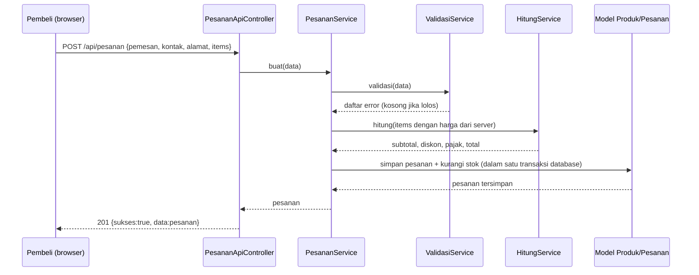

# Arsitektur dan Desain Sistem LouMart

Dokumen ini menjawab **bagaimana** LouMart dibuat. Aturan bisnis ada di `prd.md`.
Untuk hal teknis (struktur, API, format data), dokumen ini adalah acuan utama.

## 1. Keputusan Arsitektur

| Hal | Keputusan | Status |
|---|---|---|
| Bahasa backend | PHP **8.3.3** native, tanpa framework dan tanpa Composer | Final (keputusan tim) |
| Pola | MVC + lapisan Service (logika bisnis) | Final |
| Penyimpanan | MariaDB lokal pada komputer setiap anggota; skema dan data awal disamakan melalui berkas SQL | Final (keputusan dosen/tim) |
| Akses database | PDO bawaan PHP; query berparameter; kredensial berada pada konfigurasi lokal yang tidak diunggah ke GitHub | Final |
| Frontend | HTML (View PHP) + Tailwind CSS melalui CDN; JavaScript murni; komunikasi AJAX (`fetch`) berformat JSON | Final (keputusan tim) |
| Keranjang | Disimpan di `localStorage` browser, divalidasi ulang server saat checkout | Usulan |
| Login admin | Tidak ada (halaman admin dibuka langsung) | Terbuka, konfirmasi dosen |
| Pembulatan | Dibulatkan ke rupiah terdekat (setengah ke atas), hitung pakai bilangan bulat | Usulan, perlu disepakati |
| Gaya nama field API JSON | `camelCase` | Final |

## 2. Gambaran Komponen



Cara membacanya (untuk pemula):

- **Browser** meminta halaman (misalnya katalog). Server mengirim kerangka HTML dari **View**.
- Setelah halaman tampil, JavaScript memanggil **API** (misalnya `GET /api/produk`) untuk mengambil data.
- **Controller** hanya menerima permintaan dan mengirim jawaban. Aturan hitung dan validasi ada di **Service**. Baca dan tulis data MariaDB dilakukan oleh **Model** melalui PDO.

## 3. Alur Checkout (Sequence)



## 4. Struktur Folder

```text
loumart/
├── AGENTS.md
├── docs/                       prd.md, architecture.md, design.md, techstack.md, rules.md, plan.md, task.md, keputusan.md
├── public/                     SATU-SATUNYA folder yang boleh diakses browser
│   ├── index.php               front controller (semua request masuk lewat sini)
│   ├── .htaccess               rewrite ke index.php (untuk Apache/XAMPP)
│   └── assets/
│       ├── css/                style.css (CSS tambahan eksternal; Tailwind dari CDN)
│       ├── js/                 api.js, format.js, cart.js, katalog.js, keranjang.js,
│       │                       checkout.js, status-pesanan.js, admin-produk.js, admin-transaksi.js
│       └── img/                gambar produk
├── app/
│   ├── Core/                   Router.php, Request.php, Response.php, View.php, Database.php
│   ├── Controllers/            PageController.php, ProdukApiController.php,
│   │                           PesananApiController.php, RingkasanApiController.php
│   ├── Models/                 Produk.php, Pesanan.php
│   ├── Services/               HitungService.php, ValidasiService.php, PesananService.php
│   └── Views/
│       ├── layouts/main.php
│       ├── katalog.php, keranjang.php, checkout.php, status-pesanan.php
│       └── admin/produk.php, admin/transaksi.php
├── config/
│   ├── app.php                 pajak, tabel diskon, pola kontak
│   ├── database.example.php    contoh konfigurasi koneksi
│   ├── database.local.php      konfigurasi lokal (tidak diunggah ke GitHub)
│   └── routes.php              daftar route halaman dan API
├── database/                   schema.sql dan seed.sql untuk setup lokal
└── tests/
    └── run.php                 uji otomatis sederhana (gunakan database pengujian)
```

Kepemilikan folder (supaya tidak bentrok di Git):

| Peran | Area kerja |
|---|---|
| Frontend 1 | `app/Views/`, `public/assets/css/` |
| Frontend 2 | `public/assets/js/` |
| Backend/Logic | `app/Core/`, `app/Controllers/`, `app/Models/`, `app/Services/`, `config/`, `database/`, `tests/` |
| UI/UX | `docs/design.md`, `public/assets/img/` |
| PM | `docs/plan.md`, `docs/task.md`, `docs/keputusan.md`, `README.md` |

## 5. Tanggung Jawab Tiap Lapisan

| Lapisan | Boleh | Tidak boleh |
|---|---|---|
| Controller | Baca request, panggil Service/Model, kirim Response | Berisi rumus, aturan validasi, atau query database langsung |
| Service | Rumus hitung, aturan validasi, alur transaksi | Menulis HTML, membaca `$_POST`/`$_GET` langsung |
| Model | Baca/tulis data MariaDB melalui PDO dan query berparameter | Berisi aturan bisnis atau query yang merangkai input langsung ke SQL |
| View | HTML + sedikit PHP untuk menampilkan (`htmlspecialchars`) | Query data, rumus, atau menulis file |
| JS (frontend) | Menampilkan, kirim request, simpan keranjang | Menghitung total final (angka resmi dari server) |

## 6. Routing

Halaman (mengembalikan HTML):

| Metode | Path | Controller::method | View |
|---|---|---|---|
| GET | `/` | PageController::katalog | katalog.php |
| GET | `/keranjang` | PageController::keranjang | keranjang.php |
| GET | `/checkout` | PageController::checkout | checkout.php |
| GET | `/pesanan/{id}` | PageController::statusPesanan | status-pesanan.php |
| GET | `/admin/produk` | PageController::adminProduk | admin/produk.php |
| GET | `/admin/transaksi` | PageController::adminTransaksi | admin/transaksi.php |

API (mengembalikan JSON): lihat bagian 7.

## 7. Kontrak API

Semua endpoint di bawah `/api`. Request dan response memakai JSON (`Content-Type: application/json`).

### 7.1 Format response

Sukses:

```json
{ "sukses": true, "data": { } }
```

Gagal:

```json
{
  "sukses": false,
  "pesan": "Validasi gagal",
  "errors": [
    { "kode": "VAL-03", "field": "items.0.qty", "pesan": "Stok tidak mencukupi" }
  ]
}
```

Kode HTTP:

| Kode | Dipakai untuk |
|---|---|
| 200 | Berhasil (GET, PUT, DELETE) |
| 201 | Berhasil membuat data (POST) |
| 400 | JSON rusak / body tidak terbaca |
| 404 | Data atau route tidak ditemukan |
| 409 | Konflik aturan, contoh: mengubah status pesanan yang sudah final |
| 422 | Validasi gagal (VAL-xx) |
| 500 | Kesalahan server (jangan bocorkan detail internal) |

### 7.2 Daftar endpoint

| Metode | Path | Fungsi | Pengguna |
|---|---|---|---|
| GET | `/api/produk?q=&kategori=` | Daftar produk, opsional cari nama dan filter kategori | Pembeli, Admin |
| GET | `/api/produk/{id}` | Satu produk | Pembeli, Admin |
| POST | `/api/produk` | Tambah produk | Admin |
| PUT | `/api/produk/{id}` | Ubah produk | Admin |
| DELETE | `/api/produk/{id}` | Hapus produk | Admin |
| POST | `/api/pesanan/hitung` | Hitung rincian biaya tanpa menyimpan (untuk halaman checkout) | Pembeli |
| POST | `/api/pesanan` | Buat pesanan (validasi + hitung + simpan + kurangi stok) | Pembeli |
| GET | `/api/pesanan?status=` | Daftar semua pesanan | Admin |
| GET | `/api/pesanan/{id}` | Satu pesanan | Pembeli, Admin |
| PUT | `/api/pesanan/{id}/status` | Ubah status ke Lunas/Dibatalkan | Admin |
| GET | `/api/ringkasan` | Jumlah pesanan dan total pendapatan (FR-17, tambahan) | Admin |

### 7.3 Contoh request dan response

**POST /api/pesanan/hitung** dan **POST /api/pesanan**, body:

```json
{
  "pemesan": "Budi",
  "kontak": "081234567890",
  "alamat": "Jl. Merdeka No. 1",
  "items": [
    { "produkId": 1, "qty": 2 },
    { "produkId": 3, "qty": 1 }
  ]
}
```

Klien **tidak mengirim harga**. Server mengambil harga produk dari MariaDB. Untuk `/hitung`, `pemesan`, `kontak`, dan `alamat` boleh kosong (hanya `items` yang dihitung).

Response `POST /api/pesanan` (201):

```json
{
  "sukses": true,
  "data": {
    "id": "ORD-001",
    "pemesan": "Budi",
    "kontak": "081234567890",
    "alamat": "Jl. Merdeka No. 1",
    "items": [
      { "produkId": 1, "namaProduk": "Kaos Polos", "qty": 2, "hargaSatuan": 75000 }
    ],
    "subtotal": 150000,
    "diskon": 0,
    "pajak": 16500,
    "total": 166500,
    "status": "Menunggu Pembayaran",
    "tanggal": "2026-11-18"
  }
}
```

Response `POST /api/pesanan/hitung` (200): `data` berisi `subtotal`, `diskon`, `persenDiskon`, `setelahDiskon`, `pajak`, `total`.

**PUT /api/pesanan/{id}/status**, body:

```json
{ "status": "Lunas" }
```

Nilai yang boleh: `"Lunas"` atau `"Dibatalkan"`. Jika pesanan sudah Lunas/Dibatalkan, balas 409
dengan pesan "Status pesanan sudah final".

**POST/PUT /api/produk**, body:

```json
{ "nama": "Kaos Polos", "kategori": "Pakaian", "harga": 75000, "stok": 20, "gambar": "kaos.jpg" }
```

Aturan produk: `nama` wajib, `harga` bilangan bulat >= 0, `stok` bilangan bulat >= 0, `kategori` wajib.

**GET /api/ringkasan** (200):

```json
{ "sukses": true, "data": { "jumlahPesanan": 12, "totalPendapatan": 3450000 } }
```

`totalPendapatan` = jumlah `total` hanya dari pesanan berstatus **Lunas**.

## 8. Model Data dan Penyimpanan

Data utama aplikasi disimpan di MariaDB. Database lokal setiap anggota harus menggunakan struktur tabel dan data awal yang sama, disiapkan dari berkas SQL proyek:

- `produk`: katalog, harga, stok, kategori, dan nama gambar.
- `pesanan`: data pemesan, rincian perhitungan, status, dan tanggal.
- `detail_pesanan`: item pesanan, jumlah, serta harga satuan saat transaksi.

Relasi antar tabel mengikuti ERD pada PRD bagian 11. Setiap anggota membuat database lokal masing-masing dan menjalankan berkas skema serta data awal. Kredensial koneksi disimpan dalam konfigurasi lokal yang dikecualikan dari Git; berkas contoh tanpa kata sandi pribadi boleh dibagikan.

Model mengakses MariaDB melalui PDO. Semua nilai dari pengguna dikirim sebagai parameter query, bukan ditempel langsung ke SQL. Operasi checkout dan pembatalan yang mengubah beberapa baris harus memakai transaksi database: jika salah satu langkah gagal, seluruh transaksi dibatalkan.

Nama tabel/kolom database mengikuti skema SQL yang disepakati. Nama field JSON untuk API tetap `camelCase`; format API tidak menentukan cara penyimpanan internal.

Untuk pengujian, gunakan database pengujian atau data khusus yang terpisah dari database kerja anggota.

## 9. Logika Bisnis

### 9.1 Konfigurasi (`config/app.php`)

```php
return [
    'pajak_persen'   => 11,
    'diskon'         => [            // urut dari ambang terbesar
        ['min_subtotal' => 500000, 'persen' => 10],
    ],
    'pola_kontak'    => '/^(\+62|0)[0-9]{8,13}$/',
];
```

Angka tidak boleh ditulis langsung di dalam kode logika; ambil dari konfigurasi ini.

### 9.2 Rumus (`HitungService`)

Semua angka adalah bilangan bulat rupiah. Pembulatan: setengah ke atas.

```text
subtotal      = jumlah (hargaSatuan x qty)
persenDiskon  = persen dari tabel diskon sesuai subtotal (default 0)
diskon        = intdiv(subtotal x persenDiskon + 50, 100)
setelahDiskon = subtotal - diskon
pajak         = intdiv(setelahDiskon x pajak_persen + 50, 100)
total         = setelahDiskon + pajak
```

Cek terhadap PRD:

| Subtotal | Diskon | Pajak | Total |
|---|---|---|---|
| 400.000 | 0 | 44.000 | 444.000 |
| 600.000 | 60.000 | 59.400 | 599.400 |
| 150.000 | 0 | 16.500 | 166.500 |

### 9.3 Urutan validasi (`ValidasiService`)

Kumpulkan semua error lalu kembalikan sekaligus (HTTP 422).

| ID | Aturan | Pesan | Field |
|---|---|---|---|
| VAL-01 | `items` tidak boleh kosong | Keranjang masih kosong | `items` |
| VAL-02 | `qty` bilangan bulat > 0 dan bertipe angka JSON (teks seperti `"2"` ditolak) | Jumlah barang tidak valid | `items.N.qty` |
| VAL-06 | Produk harus ada di katalog | Produk tidak ditemukan | `items.N.produkId` |
| VAL-03 | `qty` <= stok (jumlah qty per produk dijumlahkan jika produk sama muncul dua kali) | Stok tidak mencukupi | `items.N.qty` |
| VAL-04 | `pemesan` wajib (setelah `trim`) | Nama wajib diisi | `pemesan` |
| VAL-05 | `kontak` wajib dan cocok `pola_kontak` (spasi dan tanda `-` dibuang dulu) | Kontak tidak valid | `kontak` |
| VAL-07 | `alamat` wajib (usulan baru, lihat bagian 10) | Alamat wajib diisi | `alamat` |

VAL-03 hanya dicek untuk item yang lolos VAL-02 dan VAL-06.

### 9.4 Status pesanan

```text
Menunggu Pembayaran --> Lunas         (final)
Menunggu Pembayaran --> Dibatalkan    (final, stok dikembalikan)
```

Perubahan selain dari "Menunggu Pembayaran" ditolak dengan 409.
Saat dibatalkan, tambahkan `qty` tiap item kembali ke stok produk. Jika produknya sudah dihapus, lewati item itu.

## 10. Perubahan dari PRD dan keputusan tim

| No | Perubahan | Alasan |
|---|---|---|
| 1 | Semua endpoint diberi awalan `/api` | Memisahkan halaman (HTML) dari data (JSON); PRD sendiri mengizinkan nama disesuaikan |
| 2 | Tambah endpoint `POST /api/pesanan/hitung` | Halaman checkout butuh rincian biaya tanpa menduplikasi rumus di JavaScript |
| 3 | Item pesanan menyimpan `namaProduk` | Riwayat pesanan tetap terbaca jika produk kemudian diubah atau dihapus |
| 4 | Klien tidak mengirim `hargaSatuan` | Mencegah harga dimanipulasi dari browser |
| 5 | Tambah VAL-07 (alamat wajib) | FR-07 meminta alamat, tapi PRD belum punya aturan validasinya |
| 6 | Aturan pembulatan setengah ke atas | NFR-03 minta bilangan bulat tanpa selisih, tapi PRD belum menyebut cara membulatkan |
| 7 | Seluruh JSON memakai `camelCase` (`produkId`, `hargaSatuan`) | ERD memakai `pesanan_id`/`produk_id`, contoh JSON memakai `produkId`; dikunci satu gaya |
| 8 | Penyimpanan aplikasi memakai MariaDB lokal tiap anggota | Ketentuan dosen meminta database; tim memilih MariaDB dan menyamakan skema/data awal melalui berkas SQL |
| 9 | Tampilan memakai Tailwind CSS melalui CDN, bukan Bootstrap | Ketentuan dosen mengizinkan library CSS eksternal; tim memilih Tailwind CDN |

## 11. Yang Masih Perlu Dikonfirmasi

MariaDB lokal dan Tailwind CDN sudah diputuskan; implementasinya masih menunggu task T-34 sampai T-36.

1. Pastikan semua laptop anggota dan tempat demo memakai PHP 8.3.3 (cek dengan `php -v`).
2. Aturan diskon dan pajak: dari dosen atau keputusan kelompok.
3. Login admin: perlu atau tidak.
4. Gambar produk: cukup nama file yang sudah ada di `public/assets/img/` (asumsi saat ini), atau perlu fitur upload.
