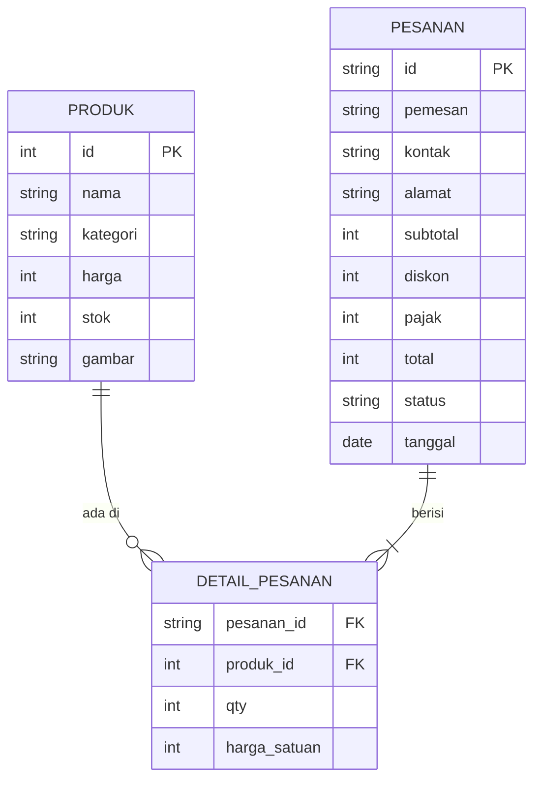

# PRD LouMart: Sistem Pemesanan dan Manajemen Penjualan

Disusun oleh: System Analyst \| Status: Draft 1.0 \| Tanggal: 18 November 2026

## 1. Ringkasan Produk

**LouMart** adalah aplikasi web toko online sederhana untuk mengelola katalog produk, keranjang belanja, transaksi pemesanan, dan status pembayaran. Aplikasi dipakai oleh dua jenis pengguna: **Pembeli** yang berbelanja, dan **Admin** yang mengelola produk serta memantau penjualan.

Inti teknis aplikasi ada pada **logika algoritma**: perhitungan total belanja, diskon, pajak, dan validasi transaksi. Penyimpanan data memakai **file JSON** (tanpa database) agar sesuai dengan lingkup tugas dan mudah dikerjakan enam orang.

## 2. Latar Belakang Masalah

Banyak usaha kecil masih mencatat pesanan secara manual lewat chat atau buku catatan. Cara ini menimbulkan beberapa masalah:

- Perhitungan total, diskon, dan pajak dilakukan manual sehingga rawan salah hitung.

- Stok barang tidak terpantau; pesanan bisa diterima padahal barang sudah habis.

- Status pembayaran sulit dilacak, sehingga pesanan bisa terlewat atau tercatat ganda.

- Rekap penjualan harus dibuat ulang secara manual setiap kali dibutuhkan.

LouMart dibuat untuk menjawab masalah tersebut dengan satu aplikasi yang menghitung otomatis, memvalidasi pesanan, dan mencatat status setiap transaksi.

## 3. Tujuan

| No | Tujuan | Ukuran keberhasilan |
|---|---|---|
| 1 | Pembeli dapat melihat produk dan memesan dengan mudah | Pembeli bisa menyelesaikan pemesanan dari katalog sampai checkout tanpa bantuan |
| 2 | Perhitungan total belanja akurat dan otomatis | Hasil hitungan sama dengan perhitungan manual pada semua kasus uji |
| 3 | Transaksi tidak valid ditolak | Semua aturan validasi pada bagian 7 berjalan |
| 4 | Admin dapat memantau penjualan dan status pembayaran | Admin dapat melihat semua pesanan dan mengubah statusnya |

## 4. Pengguna dan Aktor

| Aktor | Deskripsi | Kebutuhan utama |
|---|---|---|
| **Pembeli** | Orang yang berbelanja di LouMart, tidak wajib punya akun | Mencari produk, mengisi keranjang, checkout, melihat status pesanan |
| **Admin** | Pemilik atau pengelola toko | Mengelola produk dan stok, melihat daftar transaksi, mengubah status pembayaran |

## 5. Ruang Lingkup

### 5.1 Masuk lingkup (In Scope)

- Katalog produk dengan pencarian dan filter kategori

- Keranjang belanja

- Checkout dan pembuatan pesanan

- Perhitungan subtotal, diskon, pajak, dan total

- Validasi transaksi

- Status pembayaran (Menunggu Pembayaran, Lunas, Dibatalkan)

- Halaman admin: kelola produk dan daftar transaksi

- Penyimpanan data dalam file JSON

### 5.2 Di luar lingkup (Out of Scope)

- Integrasi payment gateway sungguhan (pembayaran hanya dicatat statusnya)

- Pengiriman dan pelacakan kurir

- Registrasi dan login pembeli

- Notifikasi email atau WhatsApp

- Penggunaan database SQL

## 6. Kebutuhan Fungsional

Prioritas: **Wajib** (harus ada untuk demo) dan **Tambahan** (dikerjakan jika waktu cukup).

| ID | Kebutuhan | Prioritas |
|---|---|---|
| FR-01 | Sistem menampilkan daftar produk (gambar, nama, harga, stok) | Wajib |
| FR-02 | Pembeli dapat mencari produk berdasarkan nama | Wajib |
| FR-03 | Pembeli dapat memfilter produk berdasarkan kategori | Tambahan |
| FR-04 | Pembeli dapat menambahkan produk ke keranjang | Wajib |
| FR-05 | Pembeli dapat menambah, mengurangi, dan menghapus item di keranjang | Wajib |
| FR-06 | Keranjang menampilkan subtotal per item dan total sementara | Wajib |
| FR-07 | Pembeli mengisi data pemesan (nama, kontak, alamat) saat checkout | Wajib |
| FR-08 | Sistem menghitung subtotal, diskon, pajak, dan total akhir | Wajib |
| FR-09 | Sistem memvalidasi transaksi sebelum pesanan disimpan | Wajib |
| FR-10 | Sistem membuat pesanan dengan ID unik dan status awal Menunggu Pembayaran | Wajib |
| FR-11 | Stok produk berkurang otomatis setelah pesanan berhasil dibuat | Wajib |
| FR-12 | Pembeli dapat melihat ringkasan dan status pesanan | Wajib |
| FR-13 | Admin dapat melihat daftar semua transaksi | Wajib |
| FR-14 | Admin dapat mengubah status pembayaran pesanan | Wajib |
| FR-15 | Jika pesanan Dibatalkan, stok dikembalikan | Wajib |
| FR-16 | Admin dapat menambah, mengubah, dan menghapus produk | Wajib |
| FR-17 | Admin dapat melihat ringkasan penjualan (jumlah pesanan dan total pendapatan dari pesanan Lunas) | Tambahan |

## 7. Logika Algoritma

### 7.1 Rumus perhitungan

```text
subtotal       = jumlah dari (harga x qty) semua item
diskon         = subtotal x persen diskon
setelah diskon = subtotal - diskon
pajak          = setelah diskon x 11%
total          = setelah diskon + pajak
```

### 7.2 Aturan diskon

| Syarat subtotal | Diskon |
|---|---|
| Kurang dari Rp500.000 | 0% |
| Rp500.000 atau lebih | 10% |

Aturan ini adalah usulan awal dan bisa diubah kelompok, selama disepakati dan ditulis di laporan.

### 7.3 Contoh perhitungan

Pembeli membeli barang dengan subtotal Rp600.000:

- Diskon 10% = Rp60.000

- Setelah diskon = Rp540.000

- Pajak 11% = Rp59.400

- **Total = Rp599.400**

### 7.4 Aturan validasi transaksi

| ID | Aturan | Pesan kesalahan |
|---|---|---|
| VAL-01 | Keranjang tidak boleh kosong | Keranjang masih kosong |
| VAL-02 | Qty harus berupa angka bulat lebih dari 0 | Jumlah barang tidak valid |
| VAL-03 | Qty tidak boleh melebihi stok | Stok tidak mencukupi |
| VAL-04 | Nama pemesan wajib diisi | Nama wajib diisi |
| VAL-05 | Kontak pemesan wajib diisi dan berformat nomor telepon | Kontak tidak valid |
| VAL-06 | Produk dalam keranjang harus masih tersedia di katalog | Produk tidak ditemukan |

## 8. Alur Status Pembayaran

```text
Menunggu Pembayaran --> Lunas
Menunggu Pembayaran --> Dibatalkan
```

- Pesanan baru selalu berstatus **Menunggu Pembayaran**.

- Admin mengubah status menjadi **Lunas** setelah pembayaran diterima, atau **Dibatalkan** jika pesanan batal.

- Status **Lunas** dan **Dibatalkan** bersifat final dan tidak bisa diubah lagi.

- Saat dibatalkan, stok produk dikembalikan.

## 9. Use Case

### 9.1 Daftar use case

| ID | Use case | Aktor |
|---|---|---|
| UC-01 | Melihat dan mencari produk | Pembeli |
| UC-02 | Mengelola keranjang belanja | Pembeli |
| UC-03 | Melakukan checkout | Pembeli |
| UC-04 | Melihat status pesanan | Pembeli |
| UC-05 | Mengelola produk | Admin |
| UC-06 | Melihat daftar transaksi | Admin |
| UC-07 | Mengubah status pembayaran | Admin |


Gambar 1. Use case diagram LouMart

Pembeli memiliki empat use case dan Admin tiga. Checkout selalu menjalankan validasi transaksi dan hitung total (include), sedangkan pengembalian stok hanya terjadi saat status diubah menjadi Dibatalkan (extend).

### 9.2 Deskripsi use case utama: UC-03 Melakukan Checkout

| Bagian | Isi |
|---|---|
| Aktor | Pembeli |
| Prasyarat | Keranjang berisi minimal satu item |
| Alur utama | 1\. Pembeli menekan tombol Checkout. 2. Sistem menampilkan form data pemesan. 3. Pembeli mengisi nama, kontak, dan alamat. 4. Sistem memvalidasi data dan isi keranjang. 5. Sistem menghitung subtotal, diskon, pajak, dan total. 6. Sistem menyimpan pesanan dengan status Menunggu Pembayaran. 7. Sistem mengurangi stok dan menampilkan ringkasan pesanan. |
| Alur alternatif | Jika validasi gagal (langkah 4), sistem menampilkan pesan kesalahan dan pembeli memperbaiki data. |
| Hasil akhir | Pesanan tersimpan dan stok terbarui |

### 9.3 Deskripsi use case: UC-07 Mengubah Status Pembayaran

| Bagian | Isi |
|---|---|
| Aktor | Admin |
| Prasyarat | Ada pesanan berstatus Menunggu Pembayaran |
| Alur utama | 1\. Admin membuka daftar transaksi. 2. Admin memilih pesanan. 3. Admin memilih status baru (Lunas atau Dibatalkan). 4. Sistem menyimpan perubahan. 5. Jika Dibatalkan, sistem mengembalikan stok. |
| Hasil akhir | Status pesanan terbarui |

## 10. Flowchart Checkout (dalam teks)

Bagian ini bisa dijadikan acuan untuk menggambar flowchart:

1.  Mulai

2.  Pembeli menekan Checkout

3.  Keranjang kosong? Jika ya, tampilkan pesan lalu selesai. Jika tidak, lanjut.

4.  Pembeli mengisi data pemesan

5.  Data valid? Jika tidak, tampilkan kesalahan lalu kembali ke langkah 4. Jika ya, lanjut.

6.  Stok cukup? Jika tidak, tampilkan kesalahan lalu kembali ke keranjang. Jika ya, lanjut.

7.  Hitung subtotal, diskon, pajak, total

8.  Simpan pesanan (status Menunggu Pembayaran)

9.  Kurangi stok

10. Tampilkan ringkasan pesanan

11. Selesai


Gambar 2. Flowchart checkout LouMart

Pesanan baru hanya disimpan jika tiga pemeriksaan lolos: keranjang tidak kosong, data pemesan valid, dan stok cukup. Jika data tidak valid, pembeli diminta memperbaikinya; jika stok kurang, pembeli kembali ke keranjang.

## 11. Model Data (dasar ERD)

Tiga entitas utama, disimpan sebagai file JSON: produk.json dan pesanan.json (detail pesanan disimpan di dalam pesanan).

### 11.1 Entitas dan atribut

| Entitas | Atribut | Keterangan |
|---|---|---|
| **Produk** | id (PK), nama, kategori, harga, stok, gambar | Data katalog |
| **Pesanan** | id (PK), pemesan, kontak, alamat, subtotal, diskon, pajak, total, status, tanggal | Satu transaksi |
| **Detail Pesanan** | id_pesanan (FK), id_produk (FK), qty, harga_satuan | Item dalam pesanan |

### 11.2 Relasi

- Satu **Pesanan** memiliki banyak **Detail Pesanan** (1 ke N).

- Satu **Produk** dapat muncul di banyak **Detail Pesanan** (1 ke N).

- Hubungan Pesanan dan Produk bersifat many-to-many, dipecah lewat Detail Pesanan.

Gambar 3. ERD LouMart: Produk dan Pesanan terhubung lewat Detail Pesanan.



### 11.3 Contoh format JSON

Produk:

```json
{ "id": 1, "nama": "Kaos Polos", "kategori": "Pakaian", "harga": 75000, "stok": 20, "gambar": "kaos.jpg" }
```

Pesanan:

```json
{
  "id": "ORD-001",
  "pemesan": "Budi",
  "kontak": "081234567890",
  "alamat": "Jl. Merdeka No. 1",
  "items": [{ "produkId": 1, "qty": 2, "hargaSatuan": 75000 }],
  "subtotal": 150000,
  "diskon": 0,
  "pajak": 16500,
  "total": 166500,
  "status": "Menunggu Pembayaran",
  "tanggal": "2026-11-18"
}
```

## 12. Halaman Aplikasi

| Halaman | Pengguna | Isi utama |
|---|---|---|
| Katalog | Pembeli | Daftar produk, kolom pencarian, filter kategori, tombol tambah ke keranjang |
| Keranjang | Pembeli | Daftar item, ubah qty, hapus, total sementara |
| Checkout | Pembeli | Form data pemesan, rincian biaya, tombol buat pesanan |
| Status Pesanan | Pembeli | Ringkasan pesanan dan status pembayaran |
| Admin: Produk | Admin | Tabel produk, tambah, ubah, hapus |
| Admin: Transaksi | Admin | Tabel pesanan, ubah status, ringkasan penjualan |

## 13. Antarmuka Data Frontend dan Backend

Agar Frontend 2 dan Backend bisa bekerja paralel, kedua pihak sepakat memakai endpoint berikut (nama dapat disesuaikan sesuai teknologi yang dipakai):

| Endpoint | Metode | Fungsi |
|---|---|---|
| /produk | GET | Ambil semua produk |
| /produk | POST | Tambah produk (admin) |
| /produk/{id} | PUT | Ubah produk (admin) |
| /produk/{id} | DELETE | Hapus produk (admin) |
| /pesanan | POST | Buat pesanan baru (validasi dan hitung di sisi backend) |
| /pesanan | GET | Ambil semua pesanan (admin) |
| /pesanan/{id} | GET | Ambil satu pesanan |
| /pesanan/{id}/status | PUT | Ubah status pembayaran (admin) |

Catatan: jika dosen hanya mengizinkan JavaScript murni di browser, fungsi di atas diimplementasikan sebagai fungsi JavaScript biasa dan data disimpan di file JSON atau localStorage.

## 14. Kebutuhan Non-Fungsional

| ID | Kebutuhan |
|---|---|
| NFR-01 | **Responsif**: tampilan nyaman di HP dan laptop (Bootstrap) |
| NFR-02 | **Mudah dipakai**: pembeli dapat checkout maksimal dalam 4 langkah |
| NFR-03 | **Akurat**: perhitungan uang memakai bilangan bulat (rupiah), tanpa selisih pembulatan antara tampilan dan data tersimpan |
| NFR-04 | **Konsisten**: format rupiah seragam (contoh: Rp599.400) |
| NFR-05 | **Dapat dijalankan** di browser modern (Chrome, Edge, Firefox) tanpa instalasi rumit |
| NFR-06 | **Mudah dirawat**: kode rapi, diberi komentar, dan memakai struktur folder yang disepakati |

## 15. Pembagian Tugas Tim

| Peran | Tanggung jawab di proyek LouMart | Hasil yang dikumpulkan |
|---|---|---|
| Project Manager | Jadwal, rapat, laporan progres, koordinasi, pengelolaan repo | Jadwal, notulen, laporan progres |
| System Analyst | PRD, use case, ERD, flowchart, latar belakang masalah | Dokumen ini, diagram use case, ERD, flowchart |
| UI/UX Designer | Wireframe dan mockup 6 halaman, palet warna, font, alur navigasi | File desain dan panduan gaya |
| Frontend 1 | Struktur HTML dan styling Bootstrap sesuai mockup | Halaman statis responsif |
| Frontend 2 | Interaksi JavaScript, keranjang, fetch/AJAX, olah JSON | Halaman yang terhubung ke data |
| Backend / Logic | Rumus total, diskon, pajak, validasi, simpan dan baca JSON | Modul logika dan penyimpanan data |

## 16. Jadwal Usulan

| Minggu | Kegiatan |
|---|---|
| 1 | PRD final, use case, ERD, wireframe; PM menyiapkan repo; format JSON disepakati |
| 2 | Frontend 1 membangun halaman; Backend membuat fungsi perhitungan dan validasi |
| 3 | Frontend 2 menyambungkan tampilan ke data; integrasi |
| 4 | Pengujian, perbaikan bug, laporan akhir, latihan presentasi |

## 17. Kriteria Penerimaan dan Skenario Uji

| No | Skenario | Hasil yang diharapkan |
|---|---|---|
| 1 | Subtotal Rp400.000 | Diskon 0, pajak Rp44.000, total Rp444.000 |
| 2 | Subtotal Rp600.000 | Diskon Rp60.000, pajak Rp59.400, total Rp599.400 |
| 3 | Checkout dengan keranjang kosong | Ditolak dengan pesan kesalahan |
| 4 | Qty melebihi stok | Ditolak dengan pesan stok tidak mencukupi |
| 5 | Nama pemesan kosong | Ditolak dengan pesan kesalahan |
| 6 | Pesanan berhasil dibuat | Status Menunggu Pembayaran, stok berkurang |
| 7 | Admin mengubah status ke Lunas | Status tersimpan dan tampil di daftar transaksi |
| 8 | Admin membatalkan pesanan | Status Dibatalkan, stok kembali |

## 18. Risiko dan Asumsi

| Risiko / Asumsi | Penanganan |
|---|---|
| Format JSON berubah di tengah jalan sehingga frontend dan backend tidak cocok | Format dikunci di Minggu 1; perubahan harus disetujui bersama |
| Anggota terlambat menyelesaikan bagiannya | PM memantau progres tiap pertemuan; Frontend bisa memakai data dummy |
| Konflik kode karena banyak orang menyunting file yang sama | Satu repo bersama, pembagian file per peran, commit rutin |
| Asumsi: tidak ada pembayaran sungguhan | Status pembayaran diubah manual oleh admin |
| Asumsi: pembeli tidak perlu login | Pesanan diidentifikasi lewat ID pesanan |
| Asumsi: aturan diskon dan tarif pajak 11% dapat disesuaikan dengan ketentuan dosen | Dikonfirmasi ke dosen di awal |

## 19. Pertanyaan Terbuka

| No | Pertanyaan | Status |
|---|---|---|
| 1 | Backend boleh PHP/Node.js atau harus JavaScript murni? | **Diputuskan tim:** PHP native dengan struktur folder MVC (lihat bagian 20). Tetap konfirmasi ke dosen. |
| 2 | Aturan diskon dan pajak ditentukan dosen atau kelompok? | **Terbuka.** Sementara pakai aturan bagian 7. |
| 3 | Login admin diperlukan atau halaman admin dibuka langsung? | **Terbuka.** Sementara tanpa login (task opsional T-32 jika diminta). |

## 20. Keputusan Teknis Setelah Draft 1.0

Keputusan ini melengkapi PRD. Detail lengkap ada di `architecture.md`.

- Backend: **PHP native 8.3.3** (tanpa framework), pola **MVC** + lapisan Service untuk logika bisnis.
- Penyimpanan: file JSON (`data/produk.json`, `data/pesanan.json`), tanpa database.
- Endpoint pada bagian 13 diberi awalan `/api` (contoh: `/api/produk`).
- Perubahan kecil dari PRD yang perlu disepakati tim dicatat di `architecture.md` bagian "Perubahan dari PRD".
- Ketentuan teknis tugas yang menjadi acuan: HTML untuk struktur halaman; CSS dan Bootstrap untuk tampilan; JavaScript untuk interaksi; AJAX untuk komunikasi data asynchronous; JSON sebagai format pertukaran data. CSS kustom ditulis di file eksternal.
